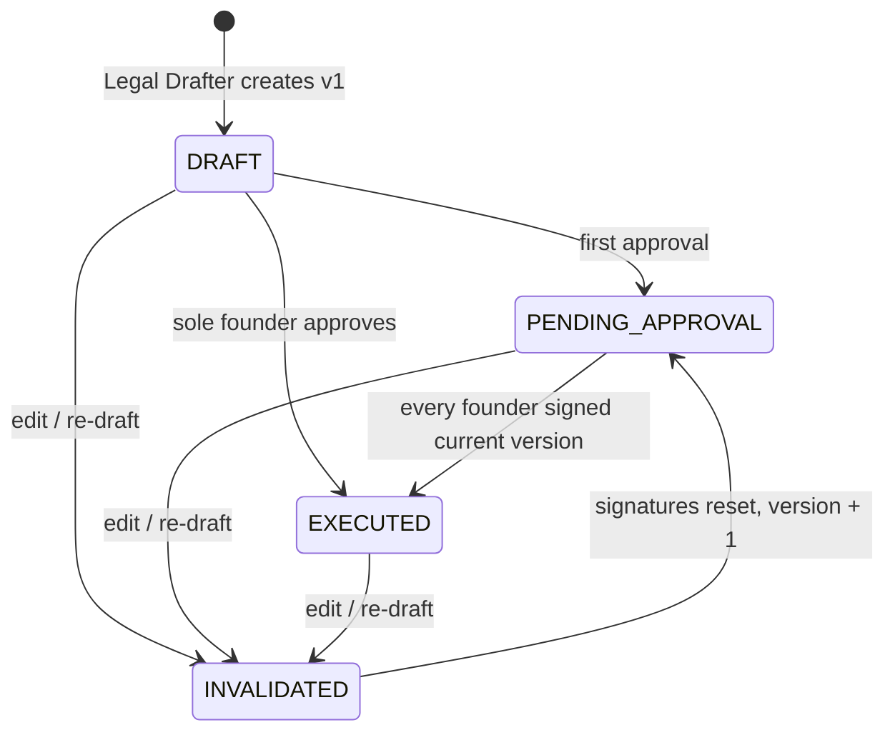

# ADR-001: Version-bound multi-party sign-off state machine

| | |
|---|---|
| **Status** | Accepted |
| **Date** | 2026-11-22 |
| **Scope** | `app/state_machine.py`, `app/models.py` (`Document`), `POST /documents/{id}/approve`, `POST /documents/{id}/edit` |

## Context

Each incorporation case produces three documents: an IP Assignment Agreement, a Bylaws Summary and an IRS 83(b) Election. Every founder must sign every document before the case can be filed.

Founders can also edit documents after they are drafted. The rule we need to enforce: **a signature means "I agree to this exact text."** If the text changes after someone signs, that signature must no longer count.

Three things complicate this:

1. **More than two founders** may be signing and editing the same document in any order.
2. **The agents can regenerate a document.** If a founder sends a new chat message after the terms are locked, the Legal Drafter re-drafts.
3. **Two people can act at the same moment** (the demo has a role switcher, and real use would have separate browsers). One founder may click Approve while another saves an edit.

## Decision

### Data model

Each `Document` row holds:

- `version`, an integer starting at 1
- `content_md`, the current text
- `status`
- `approvals`, which maps each founder's name to the version they signed, or `null`. It is stored as JSON in `approvals_json`.

```json
{"Alice Khan": 2, "Bob Lee": null, "Cara Diaz": 1}
```

A signature counts **only if it equals the current `version`**. In the example, with the document at v2, only Alice's signature counts. Cara signed v1, and v1 is gone.

There is one row per document; it is updated in place as the version grows. The audit log keeps the history of who signed and edited what.

### States



After an edit, the document checks again whether everyone has signed. If so, it goes straight from `PENDING_APPROVAL` to `EXECUTED`. This happens only when the editor is the sole founder.

| State | Meaning |
|---|---|
| `DRAFT` | Freshly generated; nobody has signed. |
| `PENDING_APPROVAL` | At least one action has happened, but not every founder has signed the current version. |
| `INVALIDATED` | Transitional state. The text changed, so existing signatures are void. The document never stays here: within the same transaction it moves on to `PENDING_APPROVAL`. It shows up only in the audit log. |
| `EXECUTED` | Every founder signed the current version. When all of a case's documents are `EXECUTED`, the case becomes `ready_to_file`. |

The allowed moves are listed in `ALLOWED` in `state_machine.py`, and every status change goes through `_transition()`. Any other move raises an error instead of silently corrupting state. Each status change writes an audit entry: `status_changed: "<doc> v<n>: FROM -> TO"`.

### Operations

**`approve(doc_id, founder_name, expected_version)`**

1. Reject the request if the caller is not a founder of the case (HTTP 400), or if `expected_version` doesn't match the current version (HTTP 409; see conflicts below).
2. If the document is already `EXECUTED`, do nothing. Approving twice is harmless.
3. Set `approvals[founder_name] = version`.
4. If every founder's entry equals `version`, move to `EXECUTED`. Otherwise move to `PENDING_APPROVAL`.

**`edit_document(doc_id, founder_name, new_content_md, base_version)`**

1. Reject a non-founder, empty content, unchanged content (HTTP 400), or a stale `base_version` (HTTP 409).
2. Move to `INVALIDATED`. This is logged against the old version.
3. Add 1 to `version` and save the new `content_md`.
4. Reset every **other** founder's approval to `null`. The editor's approval is set to the new version.
5. Write an audit entry:
   ```json
   {"document": "Corporate Bylaws Summary", "version": "v1 -> v2",
    "edited_by": "Bob Lee", "invalidated_signatures": ["Alice Khan"]}
   ```
   `invalidated_signatures` lists only founders who actually had a signature. Founders who hadn't signed yet aren't listed.
6. Move to `PENDING_APPROVAL`. If every founder has now signed, move on to `EXECUTED`.

**`redraft_document`** (the agents regenerate the text) follows the same steps with no editor. That means **every** signature is reset, because nobody has read the new text yet.

## Why version-bound invalidation

We considered four ways to make an old signature stop counting.

| Option | How it works | Why we didn't choose it |
|---|---|---|
| **A. Boolean "approved" flags, cleared on edit** | `approvals = {name: true/false}`; set them all to false when the text changes. | The record loses which text was signed. Clearing the flags and saving the text must also always happen together; if any code path forgets one, an old signature silently counts again. |
| **B. Content-hash signatures** | Store `sha256(content)` with each signature; it counts if the hash matches. | It works, but it's harder to read in the API and UI ("signed 3f9a…" instead of "signed v2"). Undoing an edit back to identical text would also quietly bring old signatures back, which is a surprise for the other founders. |
| **C. Lock the document while signatures are being collected** | No edits once anyone has signed. | Too rigid. Negotiation is the point of the review step: founders need to be able to propose changes mid-way. |
| **D. Version-bound signatures (chosen)** | Store the version each founder signed; it counts only if it equals the current version. | — |

Option D works because the rule doesn't depend on anyone remembering to clear flags. A signature on v1 can never count for v2, because `1 != 2`. Clearing the approvals on edit is only there to keep the stored data tidy and the audit log clear. The design also gives us:

- **A history that reads naturally:** "Alice signed v1; Bob's edit created v2 and invalidated Alice's signature." The API, the UI badges and the audit log all use the same version numbers.
- **The version as a lock.** The same number is used to detect conflicting actions (next section), so no second mechanism is needed.
- **A clear rule for the editor.** Saving an edit counts as agreeing to the text you just wrote, so the editor's approval moves to the new version. Everyone else must review again. A sole founder's edit therefore goes straight to `EXECUTED`.

## How multi-party edit conflicts are handled

### 1. One action after another (the normal case)

Founder A signs, then founder B edits. B's edit invalidates A's signature (version-bound rule) and the audit log records it. A sees ❌ "Signature invalidated by B's edit (v1 → v2)" and must review and sign v2. No data is lost.

### 2. Someone acts on a version they didn't see

Founder A opens v2. Meanwhile founder B saves v3. A then clicks Approve.

Without a guard, A's signature would land on v3, text A never read. To prevent this, the client sends the version it displayed:

- `POST /approve {"founder_name": "...", "version": 2}`
- `POST /edit {"founder_name": "...", "content_md": "...", "base_version": 2}`

If that doesn't match the current version, the API returns **HTTP 409 Conflict** ("it is now v3, reload and review the latest version first") and changes nothing. The UI always sends these fields and shows the 409 as a "someone changed this document first" warning.

Edit against edit works the same way. If A and B both start editing v2, the first save creates v3, and the second save is rejected with 409 instead of silently overwriting A's change. B reloads, sees A's text, and re-applies their clause edit. We chose to **reject rather than merge** because legal text is too sensitive for an automatic merge.

The fields are optional for older API clients. Without them, the server uses whatever version is current.

### 3. Truly simultaneous requests

Both requests can pass the version check before either one saves. To close that gap, `Document` uses SQLAlchemy optimistic locking:

```python
__mapper_args__ = {"version_id_col": version, "version_id_generator": False}
```

Every UPDATE then runs as `... WHERE id = :id AND version = :version_we_loaded`. If the other request already saved, zero rows match. SQLAlchemy raises `StaleDataError`, which the state machine rolls back and turns into a `VersionConflict` (HTTP 409).

A test runs this exact race: two database sessions load v2, one edits, and the other's approve fails. Because the database itself does the check, this holds even with several API worker processes.

### 4. The agents re-draft while founders are signing

A new chat message after the terms are locked re-runs the Legal Drafter. Each document gets a new version of the same record and **every** signature is reset, with the reset written to the audit log. This is the same operation as an edit by nobody, so no special handling is needed.

### 5. The set of founders changes

Approvals are always read through `get_approvals()`, which rebuilds the map from the case's **current** founders:

- A newly added founder appears as `null` (unsigned), so a document can't stay `EXECUTED` without them.
- A removed founder's signature is ignored.

In practice the founders only change when the agents re-lock the terms, and that re-drafts every document anyway.

## Consequences

**Benefits**
- An old signature can never count for new text. This is enforced by an equality check, not by remembering to clear flags.
- Every action is in the audit log: approvals, edits (with whose signatures were invalidated), re-drafts and every status change.
- Concurrent actions fail loudly with 409 instead of silently losing data.
- The whole state machine is plain Python with no LLM, so it behaves deterministically and is fully tested: 43 automated checks plus a live UI run.

**Costs and limitations**
- **No authentication.** Founder identity is a name in the request body. The UI's "Active User" switcher is a demo convenience. Production needs real login and probably an e-signature provider, but the state machine itself wouldn't change.
- **Old text isn't stored.** Only the current text is kept, plus an audit entry per edit. If we need to show "what exactly did Alice sign in v1", add a `document_versions` table with one row per version. The version-bound design already accommodates this.
- **Whole-document signatures.** Changing one clause invalidates signatures on the whole document, even though the UI edits one clause at a time. Signing individual clauses was rejected as too complex for founders to follow.
- **Conflicts need a manual retry.** On a 409 the user reloads and re-applies their change. That's acceptable when two or three founders are editing a handful of documents.
